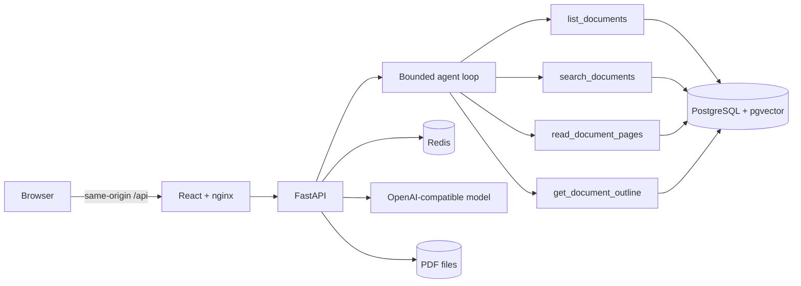

# PolicyPilot

PolicyPilot answers questions about policy documents and shows its work. A single tool-using agent plans, searches, searches again with different words when the first results are thin, asks you when a question is ambiguous, and writes an answer in which every quote has been checked against the page it came from. You can watch each step as it happens and open the original PDF at the cited page.

It is a full-stack agentic retrieval-augmented generation (RAG) application: React, FastAPI, PostgreSQL with pgvector, Redis, and any OpenAI-compatible model, all started with Docker Compose.

> The ten "Northfield University" policies are fictional and were created for this project. They are not official NYU policies. Four more documents are real, public NIST publications (see [Documents](#documents)).

## Status

This is working software that runs locally with one command. What is and is not finished:

- **Done and verified:** ingestion, hybrid retrieval, the agent and baseline, citation verification, the web app, session isolation, Redis fallback, the evaluation suite, Docker Compose, a CI workflow, and local drills (smoke test, restart persistence, Redis outage) whose output is saved in [`docs/deployment-evidence/`](docs/deployment-evidence/).
- **Not done yet:** a public deployment, a recorded demo, the manual review of every cited page, and merging to `main` (the work is on the `integration/full-stack` branch). The CI workflow is written but has not yet run on GitHub.
- **Known weak spots:** asking a clarifying question when it should, noticing that a newer policy replaced an older one, and bridging everyday wording to a policy's own terms. They are measured and explained in [`docs/evaluation.md`](docs/evaluation.md).

The checklist of what the brief asks for and where each item stands is in [`docs/submission-checklist.md`](docs/submission-checklist.md).

## What it does

**Answering**
- Upload text PDFs, or use the bundled library. Pages are parsed, cleaned, split into page-bounded chunks and indexed for both meaning and keywords.
- The agent decides what to do next: search, read whole pages, outline a document, search again with different words, ask a clarifying question, or answer. A follow-up like "what else?" prefers pages the previous answer did not use.
- Greetings, thanks and questions about the assistant get a direct reply without searching. A question that nothing in the library is about gets a plain "that does not look related" instead of a stretched answer.

**Trust**
- A claim is shown only if its quote is literal text on the cited page. A near miss is snapped to the page's own sentence; otherwise the claim is repaired once and then dropped, and the answer says what is missing.
- Text inside documents is treated as data, never as instructions (a planted "ignore your rules" line is flagged and ignored).
- The answer never shows internal evidence codes; sources appear as chips that open the cited page, or the original PDF at that page.

**Safety and operations**
- Limits on steps, tool calls, time and tokens, with one bounded retry and a useful partial answer instead of a hang.
- A demo passcode, a per-client rate limit, a daily spend cap, and strict session isolation: one browser session can never read another's turns, event streams or uploads.
- Redis holds sessions, the search cache, ingest progress, rate limits and the daily budget. If Redis is down the app reports `degraded` and keeps working from PostgreSQL.

**The app**
- Documents list with a View button for every PDF, upload, and live ingestion progress.
- A conversation with replies in chat bubbles, copy buttons, follow-up suggestions, and a readable execution trace in plain English.
- **Developer mode** (toggle in the top bar) adds metrics, timings, token counts, technical details and the Agent/Quick switch. Normal users see none of it.
- Light and dark themes (the moon button; `?theme=dark` in the address also works). Panels can be hidden for more room.
- A System design page (a diagram of the whole system with the real technology logos) and a Presentation page (ten plain-language slides; arrow keys to move, `F` for fullscreen).

**Agent and Quick mode.** In Developer mode you can switch between the full agent and a "Quick" baseline that searches once and answers once with the same quote check. The baseline exists so the evaluation can show where iteration helps and where it only adds cost.

## Documents

The library holds 14 PDFs.

- **Ten synthetic policies** from a fictional university's IT office, generated reproducibly by `corpus/generate.py` (85 pages with a banner, real tables, headers and page numbers). They are built so that questions can span documents, conflict (a 2023 and a 2025 password policy), or contain a planted prompt-injection line.
- **Four real public documents** in `corpus/reference/`: NIST SP 800-61r3 (incident response), NIST CSF 2.0, NIST SP 800-46r2 (telework and remote access) and FIPS 199 (security categorization). They are U.S. government publications, not subject to copyright in the United States, included unmodified with their sources and credit in [`corpus/reference/SOURCES.md`](corpus/reference/SOURCES.md). They test the system on real layout and vocabulary.

## Quick start

Prerequisites: Docker with Compose, `curl` and `jq`.

```sh
cp .env.example .env
```

Choose how the model is provided in `.env`:

| `LLM_PROVIDER` | What it needs | Use it for |
|---|---|---|
| `openai_compatible` (default) | `LLM_API_KEY` for OpenRouter or any OpenAI-compatible API | Real answers |
| `offline` | nothing | Running the whole stack without a key. Retrieval and quote checking are real, but answers are extractive, so quality is lower |
| `fake` | nothing | Automated tests only |

Then:

```sh
docker compose up --build -d --wait
./scripts/smoke_test.sh
```

Open http://localhost:8080. The 14 documents load in the background on first start. API documentation is at http://localhost:8080/api/v1/docs.

Stop with `docker compose down` (data is kept). `docker compose down -v` also deletes the database, so the corpus is re-ingested next time.

## Using the app

1. Ask a question, or click one of the examples. Watch the trace on the right as the agent works.
2. Click a source chip to read the cited page with the quote highlighted, then **Open the PDF at this page** to see the original.
3. Use **View** next to any document in the list to open its PDF.
4. Ask a follow-up ("what else?") or an ambiguous question to see re-searching and clarification.
5. Turn on **Developer** to see tokens, cost, latency and technical details, and to compare Agent with Quick.

Useful address options: `?theme=dark` or `?theme=light`, and `?developer=1` or `?developer=0`. Both are remembered.

## How it works



- **Agent:** a hand-written state machine (plan, act, observe, evaluate, revise or clarify, synthesize, verify, emit). The model chooses the next tool; the code enforces the limits, blocks repeated calls, rejects malformed arguments without spending budget, and decides when to stop. Prompts are versioned (`backend/app/agent/prompts/`, currently v8) and the version is recorded with every turn.
- **Retrieval:** 200-token chunks that never cross a page, vector search (BGE-small on ONNX, run locally) plus PostgreSQL full-text search, fused with reciprocal rank fusion. These settings were chosen by measuring against the evaluation cases' expected pages (`eval/retrieval_bench.py`, [ADR 0005](docs/adr/0005-page-bounded-chunking.md)): top-3 recall went from 0.80 to 0.87 and the rank of the first correct page from 0.76 to 0.88. A reranker, a larger embedding model and a heading prefix were tested and did not help.
- **Verification:** the evidence ID must come from a tool call in this turn, and the quote must be literal text on the cited page ([ADR 0007](docs/adr/0007-citation-verification.md)).
- **Off-topic check:** a search counts as off topic only when the best similarity is below 0.63 and no keyword matched. Measured: off-topic questions score at most 0.59, in-scope ones at least 0.67.
- **Data:** PostgreSQL is the source of truth (documents, pages, chunks with HNSW and full-text indexes, turns, trace events, evidence, citations). Redis holds replaceable state.

The full design is in [`docs/system-design.md`](docs/system-design.md), and the same diagram is in the app under System design.

## Configuration

Everything is an environment variable; [`.env.example`](.env.example) lists them all. The ones most often changed:

| Variable | Meaning | Default |
|---|---|---|
| `LLM_PROVIDER`, `LLM_API_KEY`, `LLM_BASE_URL`, `LLM_MODEL` | The model and where to reach it | OpenRouter, `openai/gpt-4o-mini` |
| `DEMO_PASSCODE` | If set, required to create a session, upload or send a message | empty (off) |
| `RATE_LIMIT_PER_MINUTE`, `DAILY_BUDGET_USD` | Per-client message limit and daily spend cap | 20, 1.00 |
| `AGENT_MAX_STEPS`, `AGENT_MAX_TOOL_CALLS`, `AGENT_TURN_TIMEOUT_S`, `AGENT_MAX_TOKENS_PER_TURN` | Agent limits | 8, 6, 60 s, 25,000 |
| `CHUNK_TOKENS`, `CHUNK_OVERLAP_TOKENS` | Chunk size (re-ingest after changing) | 200, 30 |
| `REFERENCE_DIR` | Folder of real reference PDFs to load | `/app/corpus/reference` in Compose |
| `FAULT_INJECTION_ENABLED` | Allows test-only fault injection (needed by one evaluation case) | false |

The running configuration, without secrets, is readable at `GET /api/v1/config` and shown on the System design page.

Do not put a key in the repository. `.env` is git-ignored.

## API

All endpoints are under `/api/v1`; the contract is [`contracts/openapi.yaml`](contracts/openapi.yaml) and CI checks that it matches the running app.

- `GET /health/live`, `GET /health/ready` (reports `degraded` when Redis is down and the number of ready corpus documents), `GET /config`
- `POST /sessions`, `GET /sessions/{id}`
- `POST /sessions/{id}/messages` starts a turn; `GET /turns/{id}` reads it; `GET /turns/{id}/events` streams its trace over Server-Sent Events
- `GET /documents`, `POST /documents` (upload), `GET /documents/{id}`, `GET /documents/{id}/pages/{page}`, `GET /documents/{id}/file` (the original PDF), `GET /ingestion/{run}`

Sessions are bound to an HttpOnly cookie. Another session's cookie gets a 404 on every session, turn, event stream, upload and ingestion route.

## Development and testing

```sh
make test            # lint, type checks and tests for backend and frontend, plus eval-case validation
make corpus          # regenerate the synthetic PDFs and manifest deterministically
make smoke           # upload-to-cited-answer smoke test against the running stack
make redis-outage    # stop Redis, show 'degraded', prove a turn still completes
make persistence     # restart everything and check documents and sessions survive
```

Backend (Python 3.12, `uv`): `ruff`, strict `mypy`, `pytest`. The integration tests need real PostgreSQL and Redis and are skipped unless you set `INTEGRATION=1` with `POSTGRES_HOST`, `POSTGRES_PORT` and `REDIS_URL` pointing at test services (CI does this and fails if any test is skipped). Full run: 82 backend tests.

Frontend (React, TypeScript, Vite): ESLint, TypeScript, Prettier and Vitest (16 tests). Node 22 or newer is required. `frontend/README.md` explains the mock-API workflow.

API drift check: `cd backend && uv run python ../scripts/check_contract.py`.

## Evaluation

`eval/cases.yaml` defines 11 frozen cases (the eight required scenarios and three extra) with expected behavior and expected source pages. `eval/run.py` calls only the REST API, runs the agent and the one-pass baseline on the same corpus and model, verifies every cited quote against the real page, and writes raw results, traces and a report.

```sh
POLICYPILOT_BASE_URL=http://localhost:8080/api/v1 python eval/run.py --output-dir eval/results/my-run
```

Reference run (`eval/results/run-2026-10-29-gpt-4o-mini-r10/`, `openai/gpt-4o-mini`, 14-document library):

- The agent passed 6 of 11 cases and the baseline 5 of the 9 it applies to, on deterministic checks.
- Every citation shown was literally on its page (14 of 14 and 9 of 9).
- The agent's average correctness is higher (0.84 against 0.68), but pass counts are within noise, and the agent uses about eleven times the tokens and takes about three times as long. On direct lookups the baseline is as good and much cheaper.
- Prompts were tuned against these same cases, and runs vary by about one case, so this is a development measurement, not a held-out test. The manual page review is not done.

The method, all ten runs and what changed between them (including an experiment that made things much worse), and the failure analysis are in [`docs/evaluation.md`](docs/evaluation.md).

## Deployment

Production uses the same Compose definition plus `compose.prod.yaml`, immutable image tags and Caddy for automatic HTTPS. It is meant to sit behind a demo passcode, the rate limit, the daily budget cap and a spend-capped provider key. Exact deploy, verify, update and rollback steps, backups and the scaling approach are in [`docs/runbook.md`](docs/runbook.md). No public deployment exists yet.

## Limitations

- English, text-based PDFs only (no scanned pages or OCR).
- The agent is unreliable at asking a clarifying question and at spotting a replaced policy; both are open (see Evaluation).
- Similarity scores cannot tell "on topic but unanswerable" from "answerable", so the model judges sufficiency from the text it reads.
- The evaluation is small and was tuned on; there is no held-out set and no load testing.
- Sessions are anonymous browser cookies behind a shared demo passcode, not user accounts.

More in [`docs/security-and-limitations.md`](docs/security-and-limitations.md).

## Documentation

- [Submission checklist against the brief](docs/submission-checklist.md) and [summary of achievements and unfinished work](docs/summary.md)
- [System design](docs/system-design.md), [architecture](docs/architecture.md) and [architecture decisions](docs/adr/)
- [Requirements and traceability](docs/requirements.md)
- [Evaluation: method, results, run history, failure analysis](docs/evaluation.md)
- [Reproducibility: corpus, models, prompts, cost](docs/reproducibility.md)
- [Runbook, demo walkthrough and deployment evidence](docs/runbook.md), [demo](docs/demo.md), [evidence](docs/deployment-evidence/)
- [Presentation plan](docs/presentation.md) and [slide-by-slide plan](docs/presentation-slides.md)
- [End-to-end completeness audit](docs/completeness-audit.md)

## AI assistance

AI coding assistants were used for planning and implementation, as the assignment permits. The commit history, contracts, tests, deterministic corpus, evaluation cases and the documented review process are there so that the result can be inspected and explained.

## License and data

The synthetic policies contain no real policy or personal data. The four NIST documents are public U.S. government publications, credited in `corpus/reference/SOURCES.md`; check NIST's own licensing note before redistributing them outside the United States. No license is granted for the code beyond review of this submission; add one before reuse.
