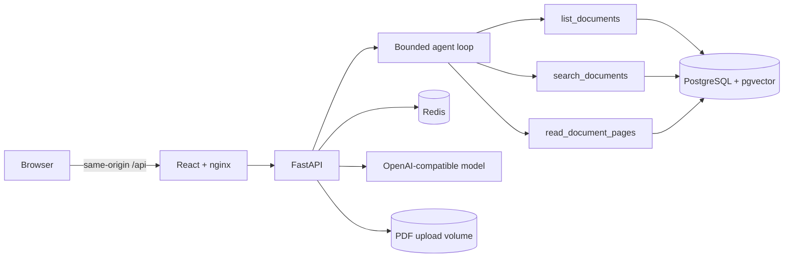

# PolicyPilot

PolicyPilot is a full-stack agentic retrieval-augmented generation application over policy PDFs. Its bounded tool-using agent can decompose questions, search and inspect documents, revise weak queries, ask for clarification, and answer with verified document/page citations. A visible trace reports actions and result summaries without exposing private chain-of-thought.

> The bundled “Northfield University” documents are fictional and were created for this take-home. They are not official NYU policies.

**Project status:** active integration. The corpus, API contracts, frontend, evaluation harness, container configuration, CI, and deployment documentation are implemented on workstream branches. Real-model evaluation results and a public URL are added only after the integrated release passes the documented checks.

## What the system demonstrates

- Upload and page-aware indexing of text PDFs.
- Hybrid PostgreSQL full-text and pgvector retrieval.
- Three corpus-scoped read-only agent tools.
- Result-driven re-retrieval and multi-document synthesis.
- Clarification, insufficient-evidence, conflict, prompt-injection, and tool-timeout behavior.
- PostgreSQL persistence and useful Redis caching/session/rate-limit roles with outage fallback.
- Agent-versus-baseline evaluation using the same corpus and model.
- Docker Compose for local and single-VM HTTPS deployment.

## Quick start

Prerequisites: Docker with Compose, `curl`, and `jq`. Copy the environment template and add an LLM key unless `LLM_PROVIDER=fake` is selected.

```sh
cp .env.example .env
```

```sh
docker compose up --build -d --wait
```

```sh
./scripts/seed_corpus.sh && ./scripts/smoke_test.sh
```

Open `http://localhost:8080`. Follow logs with `docker compose logs -f --tail=200` and stop without deleting persistent volumes using `docker compose down`.

## Architecture



The local Compose stack contains `frontend`, `backend`, `postgres`, and `redis`. Production adds Caddy for automatic HTTPS and security headers. PostgreSQL is the source of truth; Redis stores replaceable, expiring state and caches.

## Development commands

```sh
make setup          # Python environment for corpus/evaluation utilities
make corpus         # regenerate PDFs and manifest deterministically
make test           # backend, frontend and eval-contract checks
make eval-validate  # validate all 11 cases without calling the API
make eval           # run agent and baseline against the configured API
make smoke          # complete upload-to-cited-answer API smoke test
```

Frontend mock development is documented in [`frontend/README.md`](frontend/README.md). The API contract is [`contracts/openapi.yaml`](contracts/openapi.yaml).

## Evaluation

The frozen evaluation set contains the eight required scenarios and three additional cases. `eval/run.py` calls only the REST API, runs both `agent` and `baseline` modes where applicable, verifies cited quotes against page text, and records correctness checks, citations, completion, tool calls, revisions, latency, tokens, estimated cost, stop reason, and failures.

Results are written to `eval/results/<UTC timestamp>/`. No headline score is published until a full integrated run and manual page verification are complete. See [`docs/evaluation.md`](docs/evaluation.md).

## Documentation

- [System design: architecture, state, data, safety, failure modes, and scale](docs/system-design.md)
- [Presentation plan and interview walkthrough](docs/presentation.md)
- [Requirements and traceability](docs/requirements.md)
- [Architecture decisions](docs/adr/)
- [Reproducibility](docs/reproducibility.md)
- [Evaluation method and manual checks](docs/evaluation.md)
- [Security and limitations](docs/security-and-limitations.md)
- [Deployment and operations runbook](docs/runbook.md)
- [Demo walkthrough](docs/demo.md)

## Deployment

Production uses the same base Compose definition plus `compose.prod.yaml`, immutable backend/frontend image tags, and Caddy. The deployment is gated by a demo passcode, application rate and budget limits, and a provider-side capped key. Exact initial deploy, verify, update, rollback, backup, Redis outage, and persistence procedures are in [`docs/runbook.md`](docs/runbook.md).

## AI assistance

AI coding assistants were used for planning and implementation, as permitted by the assignment. The repository history, contracts, tests, deterministic corpus, evaluation cases, and documented review process make the resulting behavior inspectable. The candidate remains responsible for understanding, reviewing, and explaining every submitted component.

## License and data

No real university policy or personal data is included. Add a repository license before external reuse; this take-home repository currently provides no grant of rights beyond review of the submission.
