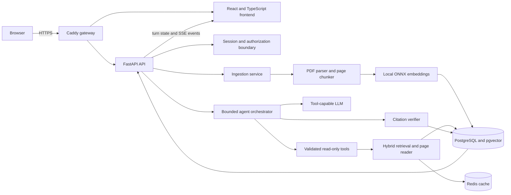
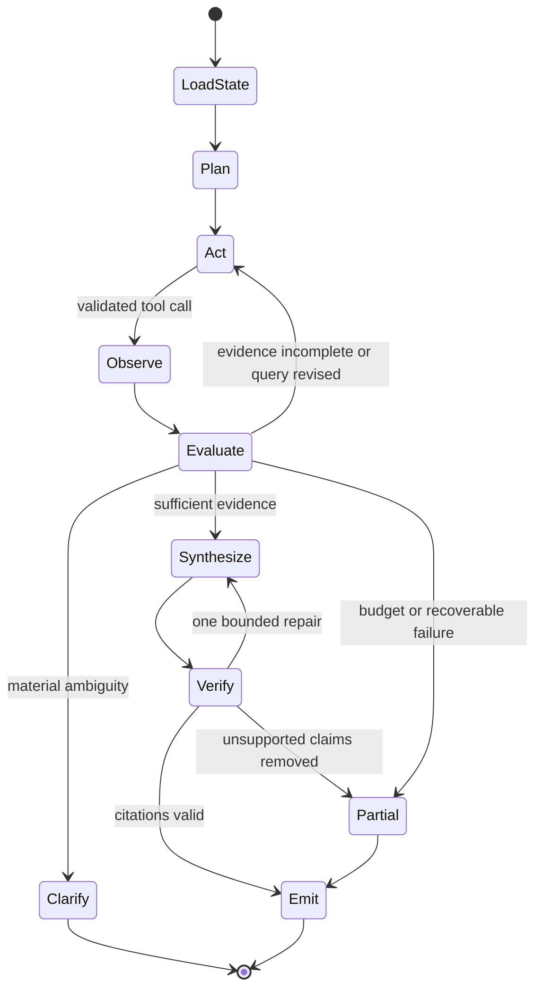

# PolicyPilot high-level system design

This document is the reviewer-facing HLD for the take-home. It describes the intended release architecture and identifies anything that is not yet verified in the current release. Detailed decisions live in `docs/adr/`.

## 1. Problem and design target

PolicyPilot is a full-stack assistant over a bounded policy-PDF corpus. A user can upload a text PDF, ask a simple or multi-part question, inspect the agent's actions, and open the exact document page supporting each material claim.

The system must do more than retrieve once and generate once. It must inspect tool results and decide whether to search again, read a specific section, ask a targeted clarification, answer, or stop because the evidence is insufficient.

### Primary users

- A policy consumer who needs a fast, verifiable answer.
- A reviewer who needs to inspect sources and execution behavior.
- An operator who needs reproducible deployment, health checks and bounded model spend.

### Scale assumptions for this release

- 8-15 PDFs per corpus, normally tens rather than millions of pages.
- Low concurrent demo traffic.
- Documents change occasionally, not continuously.
- A few seconds of latency is acceptable when the system is gathering stronger evidence.
- One deployable environment; no high-availability claim.

### Invariants

1. A session cannot retrieve another session's private uploads.
2. A material answer claim must point to evidence actually returned during that turn.
3. Retrieved document text is untrusted data, never an instruction source.
4. Limits, timeouts and retries are bounded and observable.
5. PostgreSQL is authoritative; Redis may improve speed but may not become a correctness dependency.

## 2. Requirements

### Functional

- Upload and ingest text-based PDFs.
- List documents and show ingestion status.
- Support direct, multi-document and follow-up questions.
- Expose three read-only tools: list documents, search documents and read document pages.
- Show public action summaries, tool calls, status, latency, tokens and citations.
- Ask for clarification when the request cannot be answered safely as written.
- Compare the adaptive agent against a one-pass baseline.

### Non-functional

- Groundedness and isolation before latency.
- Reproducible Docker Compose deployment.
- Durable sessions, documents, traces and evaluations.
- Graceful Redis degradation.
- Configurable model budget and request limits.
- Testable components with fake-model CI and separately labelled real-model evaluation.

## 3. Container-level architecture



### Why this boundary

- The browser never receives model or database credentials.
- All document authorization is applied server-side before text reaches a model.
- PostgreSQL keeps relational state, page text, full-text indexes and vectors together for a small corpus.
- Redis stores reconstructable acceleration state only.
- The gateway provides one origin, HTTPS and request-size controls.

## 4. Ingestion path

```text
Upload -> validate size and PDF magic -> hash -> session-scoped dedupe
       -> durable document and ingestion record -> parse by physical page
       -> strip repeated headers and footers -> page-bounded overlapping chunks
       -> local embeddings -> vector and full-text indexes -> mark ready
       -> increment corpus version and invalidate retrieval-cache namespace
```

Key choices:

- Page-bounded chunks preserve unambiguous page citations.
- Content hashes make uploads idempotent.
- A document is not searchable until its ingestion transaction completes.
- The embedding model and dimension are versioned. Changing the model requires re-embedding.
- The current small corpus does not justify a separate vector database.

Ingestion is a durable job (a row in the PostgreSQL `jobs` table, created in the same transaction as the document). A worker claims it with a lease and a fencing counter and retries it if the lease runs out; a job that keeps crashing ends as an interrupted failure and never leaves a half-searchable document ([ADR 0010](adr/0010-durable-postgres-jobs.md)). Uploaded PDFs are still on a local volume; moving them to object storage is the step that would allow more than one node.

## 5. Query and agent path



### Tool contracts

1. `list_documents(filters?)`
   - Returns authorized IDs, titles, versions and page counts.
2. `search_documents(query, document_ids?, top_k)`
   - Runs dense and lexical retrieval, fuses rankings, and returns stable evidence IDs with snippets and pages.
3. `read_document_pages(document_id, page_start, page_end)`
   - Reads a bounded, authorized page range for closer inspection.

Every result distinguishes `ok`, `empty` and `error`; includes elapsed time; and marks whether retrying is meaningful. Tools cannot execute arbitrary URLs, SQL, shell commands or file paths.

### What makes the behavior agentic

The model selects the next action after seeing real tool output. A required trace demonstrates weak initial evidence followed by a changed query or page read. Repeating a fixed pipeline with an “agent” label does not satisfy the design.

### Stopping and failure behavior

- Global model-turn, tool-call and wall-clock budgets.
- Per-tool timeout and at most one retry for transient failures.
- Duplicate call-signature detection.
- A verified partial answer on exhaustion; abstention when nothing is supported.
- A targeted clarification when different interpretations would change retrieval materially.

## 6. Retrieval design

The initial production retriever uses PostgreSQL vector similarity plus full-text search. Dense retrieval finds paraphrases; lexical search preserves policy names, IDs and exact terminology. Reciprocal Rank Fusion combines ranks without pretending the two score scales are directly comparable.

The agent receives a bounded candidate set, not the entire corpus. It may then read pages surrounding an evidence hit. Retrieval confidence is a ranking signal, not a calibrated truth probability.

### Cache-aside behavior

```text
retrieval:v1:<session>:<corpus_version>:<retriever_version>:<query+filters hash>
```

- Short TTL because entries are cheap to reconstruct.
- Corpus-version changes make stale entries unreachable.
- Errors are never cached.
- Redis timeout falls through to PostgreSQL and emits `cache_unavailable`.
- Authorization is checked even when an evidence reference came from cache.

## 7. Data model

High-level entities:

- `sessions`: expiry and ownership boundary.
- `documents`, `document_pages`, `chunks`: source identity, versions, page text, full-text vector and embedding.
- `ingestion_runs`: durable status and errors.
- `turns`: question, terminal state, model usage and stop reason.
- `trace_events`: ordered public action summaries.
- `evidence`: immutable snippets returned by tools during a turn.
- `citations`: claim-to-evidence references and verification state.
- `evaluation_runs`, `evaluation_cases`: reproducible comparison artifacts.

Indexes include a vector index, a GIN full-text index, document/session filters, and turn/event ordering.

## 8. Citation verification and safety

Before display, each citation must pass:

1. **Provenance:** its evidence ID came from a successful tool call in this turn.
2. **Location:** document and physical page match the stored evidence.
3. **Quote:** the normalized supporting quote resolves against stored page text.

One bounded repair is allowed. Unsupported claims are removed or explicitly marked, never silently presented as verified. This proves evidence provenance and quoted support; it does not prove full semantic entailment, so the evaluation includes manual claim-level review.

Prompt-injection defenses treat retrieved instructions as quoted data, expose only allowlisted read-only tools, validate every argument server-side, and test a planted adversarial passage. This reduces risk but is not described as a complete solution.

## 9. Availability and operations

### Health semantics

- Liveness: process can serve requests.
- Ready: migrations applied and PostgreSQL reachable.
- Degraded but serving: Redis unavailable; retrieval and sessions fall back to PostgreSQL.
- Not ready: PostgreSQL unavailable or schema incompatible.

### Deployment

- Frontend, backend, PostgreSQL and Redis run through Docker Compose.
- Production adds Caddy, immutable image tags and persistent volumes.
- Database/cache ports remain private.
- Release process: back up, deploy exact SHA, migrate, health check, seed and smoke test.
- Rollback means restoring the previous application image only when schema-compatible; database rollback requires the matching backup.

### Observability

- Correlation, session, turn and request IDs.
- Structured logs without secrets, cookies or hidden reasoning.
- p50/p95 latency by stage, model tokens and cost, tool failures, cache hit rate and ingestion duration.
- Product/evaluation signals: completion, abstention, citation precision and claim coverage.

## 10. Scaling path

The take-home intentionally uses one VM because the measured workload is small.

| Trigger                         | Change                                                                      |
| ------------------------------- | --------------------------------------------------------------------------- |
| More concurrent queries         | Stateless API replicas, connection pooling and provider concurrency control |
| Larger/frequent ingestion       | Durable queue, leased workers and object storage                            |
| Hundreds of thousands of chunks | Metadata prefiltering, tuned ANN index and measured reranking               |
| Multiple organizations          | Tenant identity, ACL-aware indexes and tenant-scoped encryption/audit       |
| Availability requirement        | Managed PostgreSQL/Redis, multi-instance API and independent workers        |
| Heavy evaluation traffic        | Offline evaluation workers and immutable run manifests                      |

The scaling threshold is measured chunks, concurrency and update frequency, not merely document count.

## 11. Main trade-offs

- **Explicit Python state machine over LangGraph:** easier to inspect and modify in an interview; more retry/checkpoint plumbing is owned locally.
- **PostgreSQL plus pgvector over a dedicated vector service:** one transactional system and reproducible Compose; a future very large corpus may need a specialized retrieval tier.
- **Page-bounded chunks:** precise citations; a page break can split context, mitigated by bounded adjacent-page reads.
- **Local embeddings:** deterministic and no embedding API dependency; larger container and model-version reindexing responsibility.
- **Polling/SSE events over hidden reasoning:** observable actions without exposing chain-of-thought.
- **Single VM:** appropriate, inexpensive and reproducible; explicitly not high availability.

## 12. Current-versus-target honesty check

The HLD is the target release architecture. Before submission, `docs/summary.md` must identify what is actually working at the submitted commit. No diagram arrow is evidence on its own. Each completed path needs a test, trace, screenshot or deployment artifact.

At minimum, verify:

- A real upload-to-cited-answer vertical slice.
- Result-driven re-retrieval.
- Clarification continuation.
- Tool timeout with bounded recovery.
- Redis outage degradation.
- Restart persistence.
- Agent-versus-baseline results on the fixed cases.
