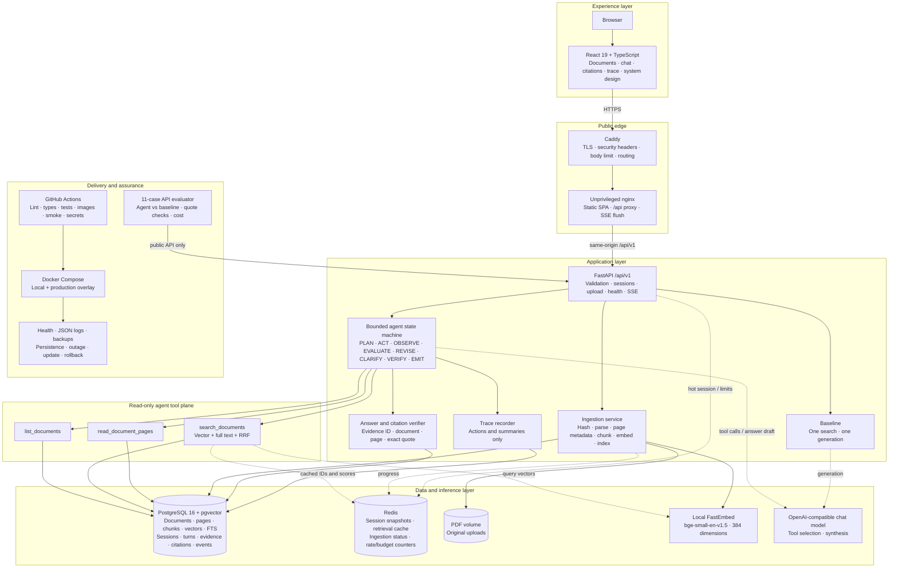
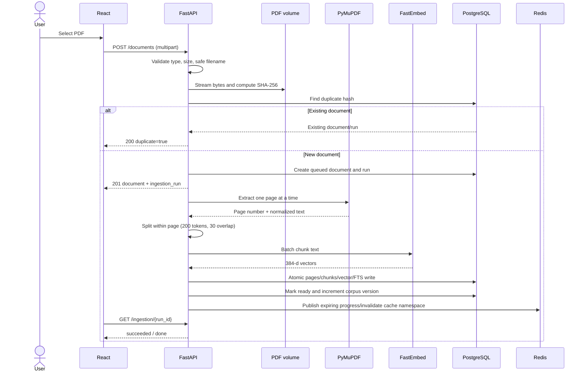
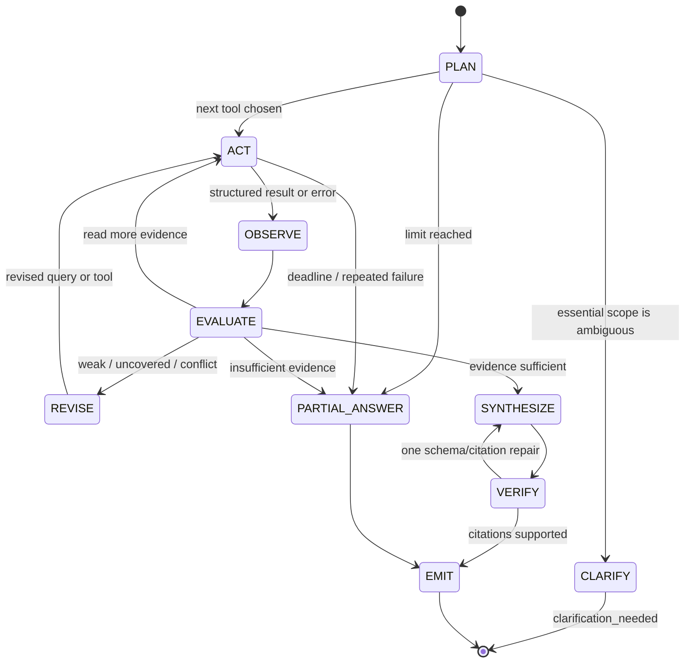
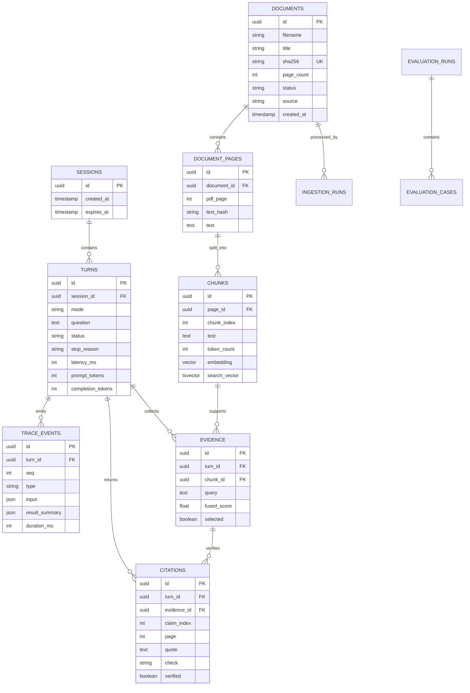
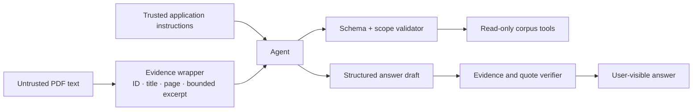
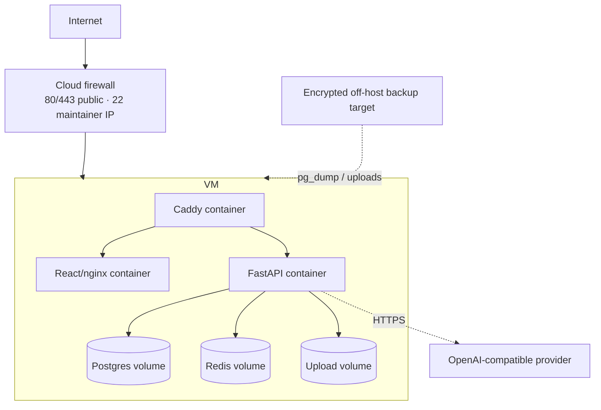

# PolicyPilot system design

## Executive summary

PolicyPilot is a full-stack agentic RAG system for asking simple, ambiguous, conflicting, or multi-document questions over 8–15 text PDFs. The system preserves page provenance from ingestion through generation, exposes a bounded action trace, and verifies citations before rendering them.

The take-home topology uses one VM and Docker Compose because it is easy to reproduce, operate, and explain. Its contracts allow the same application to move to managed data services, object storage, workers, and horizontally scaled APIs without rewriting the user experience or agent tools.

## Goals and non-goals

### Goals

- Upload and index text PDFs without losing document/page identity.
- Let one LLM-driven agent choose tools and change action after observing results.
- Ground every factual claim in retrieved evidence.
- Ask a targeted clarification instead of guessing.
- Represent missing and conflicting evidence explicitly.
- Show safe execution events, timing, token use, and cost.
- Bound steps, tools, retries, time, output, and spending.
- Preserve core behavior through Redis failure.
- Run locally and publicly from the same Compose topology.
- Compare adaptive behavior with a one-search baseline.

### Non-goals

- OCR for scanned PDFs.
- General web search.
- Write-capable or external-action tools.
- Multi-agent coordination.
- Enterprise identity or document-level authorization.
- Kubernetes or multi-region high availability in the submitted build.

## High-level architecture

## Component inventory

| Component | Responsibility | Input | Output | State | Failure behavior |
|---|---|---|---|---|---|
| React SPA | Upload, ask, clarify, inspect citations and actions | User interaction and API JSON/SSE | Accessible views | Browser session ID and unsent text | API errors remain visible and retryable |
| nginx | Serve built assets and proxy `/api` | HTTP | Static content/proxied response | None | Health check fails; Caddy returns upstream error |
| Caddy | TLS and public routing | HTTPS | Routed request | Certificate volumes | Automatic certificate retry; health exposes failure |
| FastAPI | Contract validation and request lifecycle | REST/SSE | Versioned JSON/errors/events | Durable state delegated to DB | Structured error, no stack trace |
| Ingestion | Produce searchable page-bounded chunks | Valid PDF | Document/run status and indexed chunks | PostgreSQL transaction, PDF volume | Failed run retained; partial chunks hidden |
| Agent orchestrator | Decide next action from question and observations | Session/question/tool results | Clarification or answer | Typed turn state | Verified partial answer or explicit stop reason |
| Baseline | Controlled comparison | Question | One-search answer | Turn record | No adaptive retry/clarification |
| Tools | Read-only corpus operations | Validated schemas | Bounded structured results | None outside data stores | Stable error codes/empty results |
| Citation verifier | Enforce provenance before display | Claims and evidence IDs | Verified citations/unverified claims | Evidence ledger | Unsupported claim removed or flagged |
| PostgreSQL/pgvector | Durable source of truth and retrieval | Transactions and queries | Rows/ranks/vectors | Persistent volume | Readiness down; answer generation stops safely |
| Redis | Replaceable speed/control plane | Expiring keys/counters | Cache/session/rate data | Optional AOF volume | Degraded health; DB and uncached fallback |
| Local embedding model | Encode chunks and queries | Text | 384-dimensional vectors | Container image cache | Ingestion/search dependency error |
| Chat model | Choose tools and draft grounded answer | Trusted instructions + bounded evidence | Structured tool call or answer draft | Provider-side | Timeout/retry/partial response within turn deadline |
| Evaluator | Reproduce required behavior | Cases YAML and public API | Raw JSON, report, traces | Timestamped results | Records failure; never drops a bad run |

## End-to-end ingestion flow

### Ingestion invariants

- A chunk belongs to exactly one PDF page.
- A file hash makes repeated upload idempotent.
- Parser/chunker/embedding versions determine whether re-indexing is needed.
- A document is searchable only after its successful transaction.
- Empty/scanned PDFs fail with an actionable unsupported-PDF message.
- The user filename is metadata, never a storage path.

## Question and agent flow

### Typed turn state

- Session ID, turn ID, question, prior clarification reference, and mode.
- Decomposed sub-questions and coverage status.
- Tool history, duplicate-call guard, and remaining budgets.
- Evidence ledger: evidence ID, chunk/page, query, ranks, and selection status.
- Contradictions and missing sub-questions.
- Prompt/completion token counts, latency, model, and prompt version.
- Stop reason and optional verified partial answer.

### Limits

| Limit | Default | Purpose |
|---|---:|---|
| Agent steps | 8 | Bound loops |
| Tool calls | 6 | Bound retrieval expense |
| Query revisions | 2 | Prevent reformulation loops |
| Tool retries | 1 | Recover transient failures without hiding outages |
| Tool timeout | 8 seconds | Keep one dependency from consuming the turn |
| Turn timeout | 60 seconds | Bound user latency and provider spend |
| Total turn tokens | 25,000 | Bound context and cost |
| Page read | 3 pages | Bound tool output and prompt-injection surface |

## Tool plane

### `list_documents`

Purpose: discover corpus scope and resolve document names before searching.

Input: status/title filters and bounded limit.  
Output: document ID, title, filename, page count, status, and source.

### `search_documents`

Purpose: retrieve semantically and lexically relevant page chunks.

1. Validate query, filters, and `top_k`.
2. Embed the query once.
3. Retrieve semantic candidates by pgvector cosine distance.
4. Retrieve lexical candidates by PostgreSQL full-text rank.
5. Fuse ranks with Reciprocal Rank Fusion.
6. Deduplicate chunks and return bounded excerpts with document/page metadata.
7. Mark the result weak when score/coverage rules are not met.

### `read_document_pages`

Purpose: inspect exact context and adjacent clauses before synthesis.

Input: visible document UUID and a bounded page range.  
Output: page number, title, text, truncation metadata, or a stable not-ready/not-found/out-of-range error.

All tools are read-only and accept corpus identifiers, not URLs, paths, SQL, or executable instructions.

## Evidence sufficiency and adaptive behavior

Evidence is insufficient when any of these apply:

- Search returns no hits or scores below the configured threshold.
- A multi-part question has an uncovered sub-question.
- A comparison requires multiple documents but results cover only one.
- A relevant excerpt names another clause whose page context has not been read.
- Sources conflict and both sides have not been collected.
- A tool error left a required claim unsupported.

The trace records the prior query, revised query, and result-driven reason. This observable transition is the central distinction from the baseline.

## Citation model

1. Every tool result receives an evidence ID.
2. The model drafts atomic claims with evidence IDs and short supporting quotes.
3. The backend rejects evidence IDs not observed in the current turn.
4. It resolves the authoritative title and PDF page from PostgreSQL.
5. It checks that the normalized quote occurs on that page; an overlap fallback is explicitly labeled.
6. Unsupported claims move to `unverified_claims` or are removed.
7. The UI renders numbered source chips and opens the exact page with the quote highlighted.

This proves provenance and quote presence. It does not prove semantic entailment, so the evaluation includes manual claim/page review.

## Data model

## Redis design

| Key | Value | TTL | Invalidation/fallback |
|---|---|---:|---|
| `session:{session_id}` | Active session snapshot | 24 h sliding | Rebuild from PostgreSQL |
| `search:{corpus_version}:{query_hash}:{filter_hash}` | Result IDs and ranks | 15 min | Corpus-version change makes old namespace unreachable |
| `ingest:{run_id}` | Stage and progress | 1 h after completion | Read durable ingestion run from PostgreSQL |
| `ratelimit:{client}:{window}` | Request counter | Window length | Conservative in-process limiter |
| `budget:{date}` | Estimated daily model spend | End of UTC day | Fail closed for new model calls when cap is reached |

Redis never stores irreplaceable evidence, citations, documents, or evaluation results.

## REST and streaming interface

| Method | Path | Purpose |
|---|---|---|
| GET | `/api/v1/health/live` | Process liveness |
| GET | `/api/v1/health/ready` | Database, migration, Redis, and model readiness |
| POST | `/api/v1/documents` | Upload or deduplicate a PDF |
| GET | `/api/v1/documents` | List visible corpus/uploads |
| GET | `/api/v1/documents/{id}` | Document metadata |
| GET | `/api/v1/documents/{id}/pages/{page}` | Citation page text |
| GET | `/api/v1/ingestion/{run_id}` | Ingestion status |
| POST | `/api/v1/sessions` | Create isolated session and HttpOnly binding |
| GET | `/api/v1/sessions/{id}` | Session/turn summaries |
| POST | `/api/v1/sessions/{id}/messages` | Start agent or baseline turn |
| GET | `/api/v1/turns/{id}/events` | SSE action trace |
| GET | `/api/v1/turns/{id}` | Complete turn and polling fallback |

Errors use one envelope and stable codes: invalid argument, not found, not ready, too large, unsupported PDF, rate limited, budget exhausted, unauthorized, dependency unavailable, and internal.

## Observability

### User-visible

- Tool/action type and safe validated input.
- Hit count, weak flag, top document/pages, retry, and duration.
- Query revision with result-driven reason.
- Verified citations, total steps/tools/revisions, tokens, latency, cost, and stop reason.
- No hidden chain-of-thought or raw system prompt.

### Operator-visible

- Structured JSON logs with request/session/turn correlation IDs.
- Endpoint, database, retrieval, tool, model, and ingestion timings.
- Dependency state and degraded-mode counters.
- Error class, retry count, model ID, and prompt version.
- No keys, passcodes, cookies, full documents, or private reasoning.

## Safety and trust boundaries

The system does not execute retrieved instructions. Uploads are data, SQL is parameterized, HTML is escaped, tool arguments are revalidated after model generation, and public spending is bounded at both application and provider levels.

## Failure modes

| Failure | Detection | User behavior | Recovery |
|---|---|---|---|
| Redis unavailable | Readiness check/command error | Degraded banner; questions continue uncached | DB session fallback; restart Redis |
| PostgreSQL unavailable | Readiness down | New work blocked with dependency message | Restore service/backup; no fabricated answer |
| Model timeout | Per-call timeout | One retry if transient, then supported partial result | Retry later or switch configured provider |
| Search timeout | Tool timeout/fault event | One bounded retry; explicit incomplete notice | Diagnose DB/index, preserve trace |
| Empty PDF/scanned PDF | Extraction validation | Upload marked failed with OCR guidance | Submit text PDF or add OCR pipeline |
| Weak retrieval | Score/coverage assessment | Query-revised event | Reformulate, list corpus, or read pages |
| Conflicting policies | Multiple dated passages | Cite both and explain uncertainty | Human chooses authoritative source |
| Citation mismatch | Quote/provenance verifier | Unsupported claim removed/flagged | One repair using existing evidence only |
| Step/token/time limit | Budget counters/deadline | Verified partial findings and stop reason | Narrow question or raise reviewed limits |
| Daily budget reached | Redis/provider budget | New paid calls fail closed | Operator raises cap or waits for reset |

## Deployment topology

Updates use immutable image tags and expand/contract migrations. A normal rollback changes backend/frontend image tags without restoring the database. The runbook verifies health, one cited answer, persistence, Redis outage, update, and rollback.

## CI/CD gates

1. Corpus generation and byte-diff check.
2. Evaluation case JSON Schema and manifest validation.
3. Backend lint, type check, unit/integration tests with PostgreSQL and Redis.
4. Frontend lint, component tests, TypeScript build.
5. Backend and frontend image builds.
6. Compose smoke test with deterministic fake model.
7. Secret scan.
8. Explicit real-model evaluation outside routine CI.
9. Tagged release, migration, deployment, smoke, and evidence capture.

## Evaluation design

The evaluator runs 11 cases through the public API. Eight match the assignment exactly; extras test adaptive vocabulary, one-document multi-part completion, and follow-up context. Agent and baseline share corpus, model, chunking, and retrieval. CASE-4 and CASE-8 are marked baseline-inapplicable rather than counted as automatic wins.

Recorded per case/system:

- Expected behavior and source pages.
- Actual answer and trace.
- Required/forbidden facts.
- Citation quote-on-page checks and manual claim review.
- Completion/pass-fail/failure note.
- Tool calls, revisions, retries, latency, tokens, cost, and stop reason.

## Capacity and scaling

### Take-home assumptions

- 8–15 PDFs, roughly 100 pages or less.
- Fewer than 10 concurrent demo users.
- Small embedding model loaded in one API container.
- PostgreSQL and Redis colocated on one VM.

This load does not justify distributed infrastructure.

### Growth path

| Pressure | First change | Later change |
|---|---|---|
| Large/slow uploads | Redis-backed ingestion worker | Worker autoscaling and queue partitions |
| More PDF bytes | Encrypted object storage | Lifecycle/retention tiers |
| More query traffic | Multiple stateless API replicas | Autoscaling with load shedding |
| Larger vector corpus | Tune pgvector indexes/partitioning | Managed vector/search service if measured need exists |
| Availability requirement | Managed PostgreSQL/Redis | Multi-zone replicas and tested failover |
| Multiple institutions | Tenant and corpus IDs in every key/query | Policy engine and tenant-isolated storage |
| Enterprise users | OIDC/SAML SSO | RBAC/ABAC, audit exports, retention controls |
| Operational maturity | OpenTelemetry and central logs | SLOs, alerts, incident playbooks |

## Key trade-offs

- **Hand-written loop over LangGraph:** less framework capability, but every state, limit, and trace event is explicit and explainable.
- **PostgreSQL plus pgvector over a separate vector database:** fewer systems and transactional provenance, with less specialized vector scaling.
- **Local embeddings over hosted embeddings:** predictable cost and offline retrieval, with a larger image and one model loaded per API replica.
- **Page-bounded chunks over cross-page semantic chunks:** reliable page citations, at the cost of occasionally splitting a concept at a page boundary.
- **SSE plus polling fallback:** better live trace experience, with a second delivery path to test.
- **One VM over managed orchestration:** reproducible and affordable for the assignment, but one failure domain.
- **Shared demo gate over enterprise auth:** adequate cost protection for reviewers, not suitable authorization for institutional deployment.
